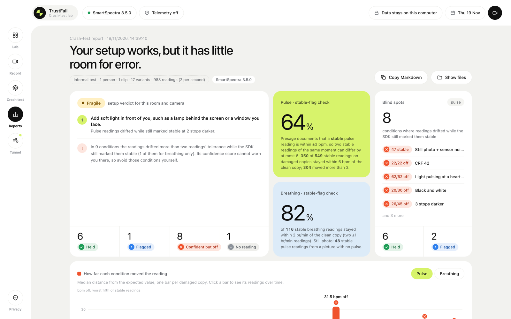
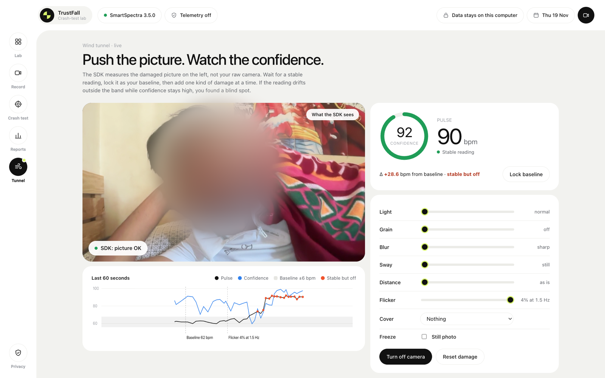
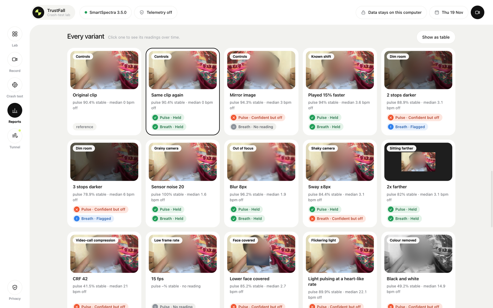
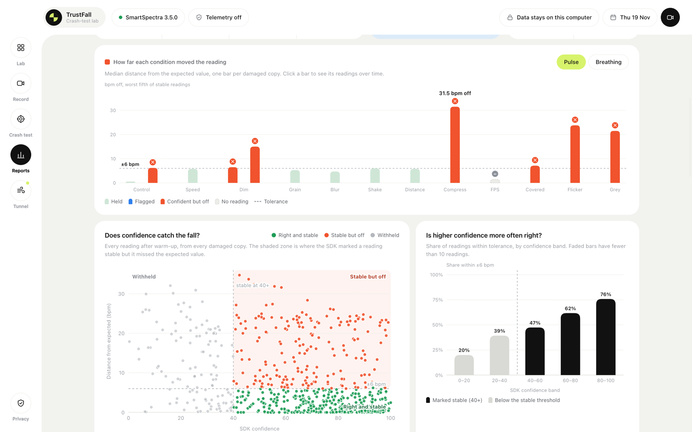
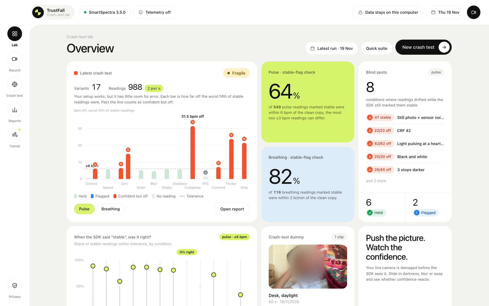
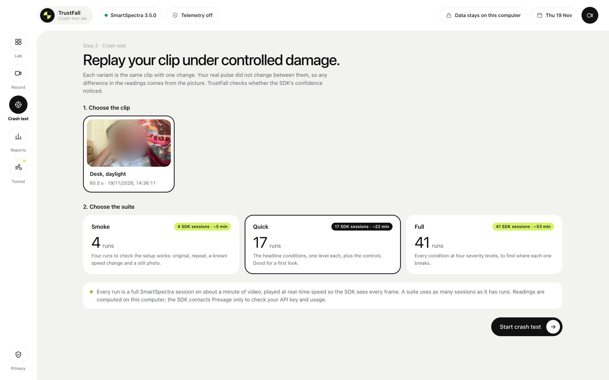
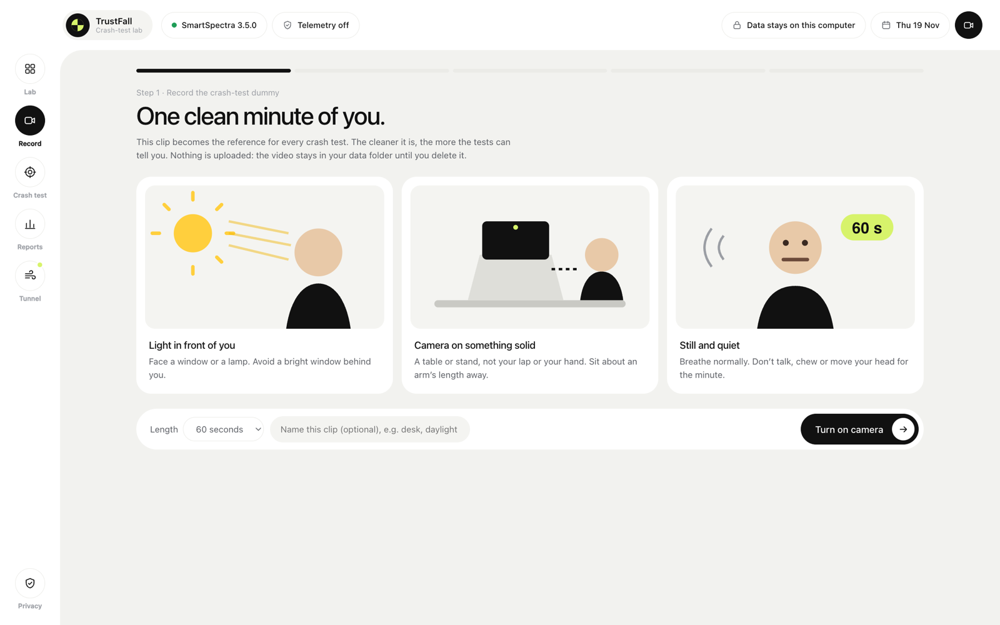
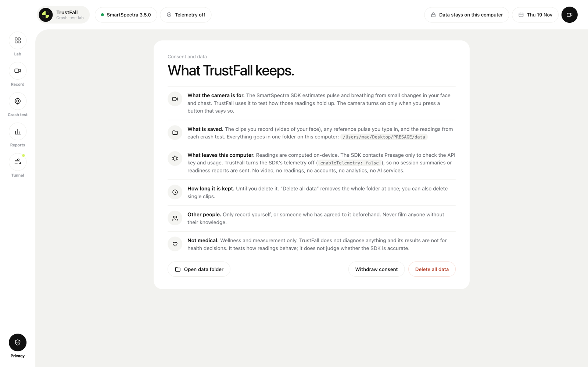
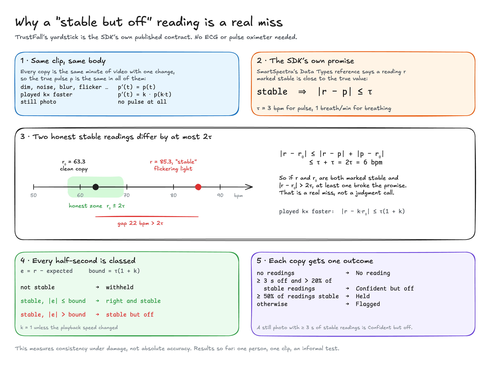
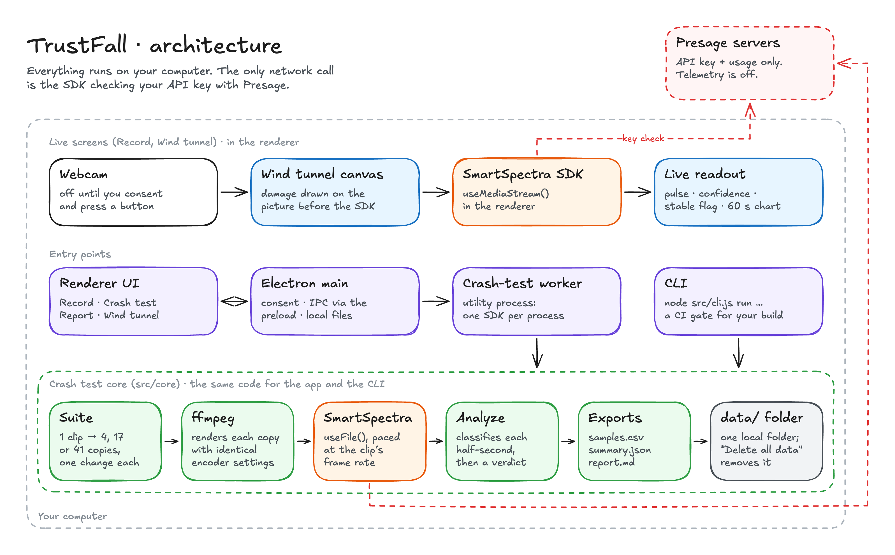

<p align="center">
  
</p>

<h1 align="center">TrustFall</h1>

<p align="center">
  <b>Find out in one minute whether your camera, room and lighting are good enough for camera vital signs.</b><br>
  A crash-test lab for the <a href="https://github.com/Presage-Security/SmartSpectra">SmartSpectra SDK</a>.
</p>

<p align="center">
  <a href="#quick-start">Quick start</a> ·
  <a href="#why-trustfall">Why TrustFall</a> ·
  <a href="#how-it-works">How it works</a> ·
  <a href="#the-maths-behind-the-verdict">The maths</a> ·
  <a href="#architecture">Architecture</a>
</p>

<p align="center">
  
</p>

> [!NOTE]
> Wellness and measurement only. TrustFall is not a medical device and does not diagnose anything. It reports how the SDK's readings behave on your setup, not whether the SDK is accurate.

## Why TrustFall

Camera vital signs are convenient: no strap, no clip, just the laptop you already have. But a camera only sees what your room lets it see. A dim kitchen, a flickering office light or a heavily compressed video call can change the reading, and sometimes the SDK still marks it **stable**. Nothing on screen tells you.

TrustFall answers three questions before you rely on the numbers:

- **Is my setup good enough?** You get a verdict for your own camera, room and light (Ready, Fragile or Not ready) and the fix that matters most, with the evidence behind it. Mine said: *"Add soft light in front of you, such as a lamp behind the screen or a window you face. Pulse readings drifted while still marked stable at 2 stops darker."*
- **When can I trust "stable"?** Every reading is checked against the SDK's own published promise, so you can see where its confidence catches a bad picture and where it doesn't.
- **What should I avoid?** You get a list of the conditions where readings moved while still marked stable. Confidence can't warn you there, so the list does.

**Who it's for**

| You are… | TrustFall gives you |
| --- | --- |
| Someone using camera vitals for wellness check-ins | A one-minute check of your room, with fixes you can act on today |
| A developer building on SmartSpectra | Evidence about the conditions your users should avoid, ready for your docs or onboarding |
| A team shipping a camera-vitals feature | The same crash test as a CI gate that fails the build when the stable flag gets fooled |

## What you get

<p align="center">
  
</p>

**Wind tunnel.** Lock a baseline, then drag sliders for darkness, grain, blur, sway, distance and flicker. The damage is applied to the picture *before* the SDK sees it, so you watch confidence react in real time. Above, a 4% flicker at 1.5 Hz (90 bpm) moved the reading from a 62 bpm baseline to 90 bpm, and the SDK kept it marked stable at confidence 92.

<table>
  <tr>
    <td width="50%"><br><b>Every damaged copy</b>, with its thumbnail, readings and outcome for pulse and breathing.</td>
    <td width="50%"><br><b>Does confidence catch the fall?</b> Every reading against SDK confidence, and how often each confidence band was right.</td>
  </tr>
  <tr>
    <td width="50%"><br><b>Overview</b> of the latest run: stable-flag checks, blind spots and how far each condition moved the reading.</td>
    <td width="50%"><br><b>Choose a suite</b>: 4, 17 or 41 full SDK sessions on the same clip.</td>
  </tr>
  <tr>
    <td width="50%"><br><b>Record one clean minute</b>, with setup tips. The camera turns on only when you press the button.</td>
    <td width="50%"><br><b>Consent and data</b>: what is kept, what leaves the computer, and one button to delete it all.</td>
  </tr>
</table>

<sub>Faces are blurred in these screenshots. The wind tunnel shot plays a recorded clip as the camera; the <a href="#the-maths-behind-the-verdict">maths</a> and the rest of the app are the same either way.</sub>

Every run also exports `samples.csv` (every reading), `summary.json` and a `report.md` you can paste into an issue.

## How it works

You can't put an ECG next to your laptop at home, so TrustFall gets an expected answer another way:

1. **Record one clean minute of yourself.** The app opens on a consent screen, and the camera turns on only when you press a button that says so.
2. **Replay it through the SDK as damaged copies**, one change at a time: darker, grainy, blurred, swaying, farther away, video-call compression, 15 fps, lower face covered, flickering light, colour removed, a still photo. Your real pulse is identical in every copy, so if a reading moves, the picture moved it. This is *metamorphic testing*, a standard way to test systems that have no ground truth.
3. **Score every half-second against the SDK's own contract** (below), then give each copy one outcome and the setup a verdict with fixes.

For some copies the expected answer is known exactly:

| Copy | Expected reading | Why |
| --- | --- | --- |
| Most damage (dim, blur, sway, …) | same as the original | only the picture changed |
| Played 15% faster / slower | original × 1.15 / × 0.85 | time is compressed, so true rates scale exactly |
| Mirror image, same file twice | same as the original | a face reads the same in a mirror; a replay should repeat |
| Still photo (± sensor noise) | **no reading** | a frozen frame has no pulse or breathing |

## The maths behind the verdict

<p align="center">
  
</p>

SmartSpectra's [Data Types reference](https://smartspectra.presagetech.com/docs/data-types) promises that a reading $r$ marked **stable** is within $\tau$ of the true value $p$, with $\tau = 3$ bpm for pulse and $1$ br/min for breathing. Every copy is the same recording, so $p$ is the same in all of them. If the clean copy reads $r_0$ and a damaged copy reads $r$, and both are marked stable, the triangle inequality gives

$$|r - r_0| \le |r - p| + |p - r_0| \le 2\tau = 6\ \text{bpm}.$$

So a stable reading more than $2\tau$ from the clean copy means at least one of the two broke the SDK's promise. TrustFall only calls a reading off in that case, so it never has to guess. For a copy played $k$ times faster the true rate scales too, and the bound becomes $|r - k\,r_0| \le \tau(1 + k)$.

Readings after warm-up are resampled to two per second, and each half-second is classed with $e = r - \text{expected}$:

- **withheld**: not marked stable
- **right and stable**: stable and $|e| \le \tau(1 + k)$
- **stable but off**: stable and $|e| > \tau(1 + k)$

Each copy then gets one outcome: **No reading** (nothing after warm-up), **Confident but off** (at least 3 s of stable-but-off readings making up more than 20% of its stable readings), **Held** (at least half its readings stable) or **Flagged** (the SDK lowered its confidence, which is the honest response). A still photo with 3 s or more of stable readings is Confident but off. Stable readings more than $\tau$ from the clean copy are also counted as *moved*: a consistency signal, not proof of an error. The code is in [`src/core/analyze.js`](src/core/analyze.js).

## What I found on my setup

**Sample: 1 person (me), 1 clip of 60 s, MacBook Air camera, daylight, 17 SDK sessions, 988 half-second readings.** This is an informal test of one setup, not a validation study.

- **Ordinary damage held.** Sensor noise, 8 px blur, ±8 px sway, a face at twice the distance and a 15% speed change all kept pulse readings within tolerance. Replaying the same file gave identical readings.
- **The SDK refused when it should.** At 15 fps it gave no reading and said why ("Frame rate too low"). A frozen photo got 1 stable half-second.
- **Flicker is the condition to avoid.** A 2% brightness flicker at 85.3 bpm pulled the median reading to exactly 85.3 bpm, and all 62 stable half-seconds were more than 6 bpm off. SmartSpectra's [model card](https://smartspectra.presagetech.com/docs/model-cards-and-limitations) warns about flickering light, and this measures it.
- **Also worth avoiding:** a dark room, heavy video-call compression (CRF 42), a covered lower face, and a still photo with camera-like noise (47 stable half-seconds).
- **Confidence carries information, but not enough to rely on alone.** The share of pulse readings within 6 bpm rose with confidence: 20% (0–20, n = 35), 39% (20–40, n = 89), 47% (40–60, n = 137), 62% (60–80, n = 193), 76% (80–100, n = 219).
- **Overall, 350 of 549 stable pulse half-seconds (64%) stayed within 6 bpm** of the clean clip. Breathing: 95 of 116 (82%) within 2 br/min.

## Architecture

<p align="center">
  
</p>

- **Live screens** (Record, Wind tunnel) run the SDK in the renderer with `useMediaStream()`. The wind tunnel draws the damage on a canvas and hands the SDK that canvas's stream.
- **Crash tests** run in an Electron utility process, because the SDK's native state is per process. Each copy is a full SDK session via `useFile()`, paced at the clip's own frame rate.
- **The CLI** uses the same `src/core` as the app, so a CI run and a desktop run produce the same report.
- **Network:** the SDK checks your API key and usage with Presage. Every session is created with `enableTelemetry: false`, so no video, readings or session summaries are sent.

The diagrams are Excalidraw files in [`docs/diagrams`](docs/diagrams). Open them at [excalidraw.com](https://excalidraw.com) to edit.

```
src/core/      suite (variants), media (ffmpeg), measure (SDK runner), analyze, crash (orchestration), export, store
src/main/      Electron main process, crash-test worker (utility process), preload bridge
src/renderer/  UI: record, crash test, report, wind tunnel, hand-written SVG charts
src/cli.js     command-line runner
test/          analysis tests (npm test)
```

## Quick start

Requirements: macOS on Apple Silicon, Windows x64 or Linux x64/arm64 (the SDK's Node platforms), Node 20+ and ffmpeg.

```bash
git clone https://github.com/SCARPxVeNOM/presage-hack.git && cd presage-hack
npm install
brew install ffmpeg                # or apt install ffmpeg / choco install ffmpeg
cp .env.example .env               # then paste your key into .env
npm start                          # builds and opens the app
```

Get an API key at [physiology.presagetech.com](https://physiology.presagetech.com/auth/register) and put it in `.env` as `SMARTSPECTRA_API_KEY=...`. `.env` is git-ignored; never commit a key. The SDK's native runtime arrives with `npm install`.

No key yet? `npm run mock` opens the app with a synthetic stand-in for the SDK so you can explore the interface. Mock runs are labelled **MOCK DATA** everywhere and must not be cited.

## Command line and CI

```bash
npm run crash -- path/to/face.mp4 --suite quick     # import + crash test, prints a summary
node src/cli.js suites                              # list every variant in smoke / quick / full
node src/cli.js list                                # clips and runs
node src/cli.js report <runId>                      # re-analyse a saved run
```

Suites: `smoke` (4 runs), `quick` (17 runs: every condition at one level, plus controls) and `full` (41 runs: every condition at four levels). Each run is a full SDK session on about a minute of video, so a session takes about as long as the clip.

As a CI gate:

```yaml
- run: npm ci && sudo apt-get install -y ffmpeg
- run: node src/cli.js run test-assets/face.mp4 --suite quick --min-kept 80 --fail-on-fooled
  env:
    SMARTSPECTRA_API_KEY: ${{ secrets.SMARTSPECTRA_API_KEY }}
```

`--min-kept N` fails the job when fewer than N% of stable pulse readings were within 6 bpm ($2\tau$) of the clean copy; `--fail-on-fooled` fails it if any copy came out Confident but off. Use a clip of someone who has agreed to be in your test assets.

> [!TIP]
> Feed recorded video at real time. `useFile()` takes `interframeDelayMs`, and `0` means "as fast as possible". On a 60 s clip that made the SDK drop 698 of 1,799 frames and send 2 pulse readings instead of 55. TrustFall paces each copy at its own frame rate (`1000 / fps`); set `TRUSTFALL_FRAME_DELAY_MS` to override.

## Limits

One person, one clip and one camera make an **informal test**, not a validation study; every result is shown with its sample size. The damage is simulated: a darkened video is not the same as a dark room, which also changes camera exposure and noise. The expected value is the SDK's own reading of the original clip, so TrustFall measures *consistency under damage*, not absolute accuracy. If you add a reference reading (pulse oximeter or watch), the report compares it with the original clip.

---

Built for the [DEV Presage SmartSpectra SDK Challenge](https://dev.to/challenges/presage-2026-11-04). TrustFall's code is MIT licensed; the SmartSpectra SDK has its own licence.
